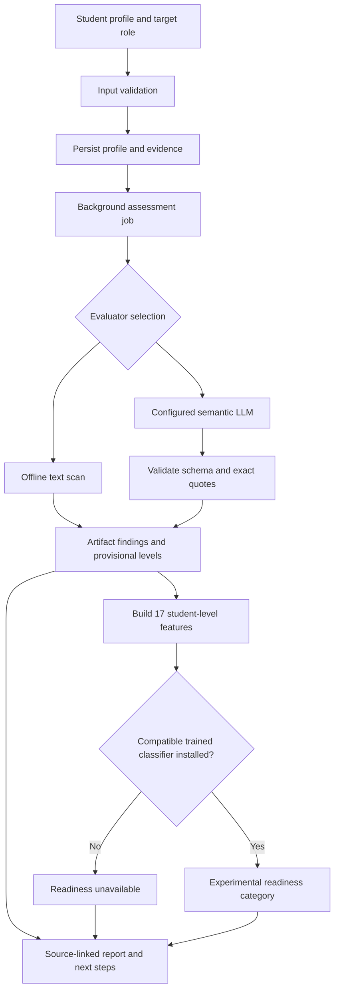

# SkillsBridge: Actual Model and Assessment System

**Documentation date:** 1 November 2026  
**Scope:** What is implemented in this repository, what is saved in the legacy model, and what still requires training or validation.  
**Prototype API:** `2.0.0`  
**Evidence feature schema:** `evidence-v2`  
**Assessment rubric:** `role-rubric-1.1`

## 1. Current status

SkillsBridge contains two separate implementations. They must not be treated as interchangeable.

| Component | Actual state |
| --- | --- |
| Legacy numerical model | A fitted, three-class, calibrated XGBoost artifact exists at the repository root. |
| Current Colab notebook | A training workflow using six numerical inputs; it does not match the fourteen-input saved artifact. |
| New evidence prototype | A working API and interface that assess submitted text and create source-linked reports. |
| Offline evaluator | Implemented deterministic text scan; available without credentials. |
| Semantic evaluator | Supports a local LM Studio model or remote Anthropic model. Local Qwen completed a live synthetic integration check. |
| New readiness classifier | Training and inference code exists; no trained replacement model is bundled. |
| Real evidence training data | Not supplied. |
| Measured real-world readiness accuracy | Not available. |
| Validated placement probability | Not available. |

The new prototype does not reuse the old XGBoost artifact. Without an installed compatible evidence model, it explicitly returns an unavailable readiness state.

## 2. Purpose and prediction target

The evidence system is intended to help students and mentors understand:

- What a project or experience appears to demonstrate.
- How substantial the described contribution is for a target role.
- What is supported by the submitted source and what remains unknown.
- Which additional evidence or assessment would be useful.

The proposed supervised target is an **independent expert's assessment of readiness for an entry-level role**. Its classes are:

| Label | Intended interpretation |
| --- | --- |
| `foundation_developing` | Substantial guidance is needed on representative entry-level tasks. |
| `developing_independence` | Some tasks can be completed independently, with identifiable gaps. |
| `entry_level_ready` | Representative tasks can be completed and implementation choices explained. |

These labels require a consistently applied human rubric and suitable practical evidence. The application does not generate ground-truth readiness labels.

Predicting these expert categories is different from predicting whether a student will receive an offer. Offer outcomes also depend on opportunities, eligibility, applications, interview conditions, and the hiring market.

## 3. Architecture



The prototype has an assessment stage and an optional supervised prediction stage. It does not currently implement RAG, a vector database, a fine-tuned language model, a learned ranking network, or a multi-agent assessment system.

The semantic implementation uses **one structured LLM request per artifact**. A separate fact-extraction pass followed by a separate judgement pass was discussed as a design option, but is not implemented.

## 4. Supported roles

| API value | Context supplied to the evaluator |
| --- | --- |
| `junior_backend` | API implementation, data handling, testing, deployment, technical explanation. |
| `junior_frontend` | Accessible interfaces, state and data handling, testing, delivery, technical explanation. |
| `junior_data` | Data preparation, appropriate evaluation, reproducible analysis, delivery, technical explanation. |

These are prototype role definitions, not independently validated occupational standards. A category should be interpreted within its target role.

## 5. Input contract

### Student profile

| Field | Required/default | Validation |
| --- | --- | --- |
| `student_name` | Required | 2–100 characters. |
| `target_role` | Defaults to `junior_backend` | One of the three supported roles. |
| `cgpa` | Optional, otherwise `null` | 0–10. |
| `communication_score` | Optional, otherwise `null` | 0–100. |
| `coding_score` | Optional, otherwise `null` | 0–100. |
| `evidence` | Defaults to an empty list | Up to 12 artifacts. |
| `evaluator` | Defaults to `auto` | `auto`, `offline`, or `llm`. |
| `dataset_origin` | Defaults to `user_supplied` | `user_supplied` or `synthetic_example`. |

Unavailable numerical values remain null in assessment features. The system does not fabricate LeetCode ratings, GitHub activity, or other measurements from a coding score.

### Evidence artifact

| Field | Validation |
| --- | --- |
| `kind` | `project`, `internship`, `certification`, `coding`, or `communication`. |
| `title` | 2–160 characters. |
| `content` | 20–24,000 characters of source text. |
| `source_url` | Optional HTTP/HTTPS URL; supplying a URL does not verify its contents. |

The request has a combined evidence limit of 72,000 characters. Input models reject undeclared fields, including a student-supplied `verified` flag. The application also rejects declared `Content-Length` values above 250 KB; this is not a substitute for comprehensive reverse-proxy request limits.

### Example request

```json
{
  "student_name": "Mira Patil",
  "target_role": "junior_backend",
  "cgpa": 8.1,
  "communication_score": 72,
  "coding_score": null,
  "evaluator": "auto",
  "dataset_origin": "user_supplied",
  "evidence": [
    {
      "kind": "project",
      "title": "Laboratory reservations",
      "content": "I implemented a reservation API with input validation. Integration tests cover booking conflicts. My mentor reviewed the database transaction design.",
      "source_url": null
    }
  ]
}
```

This is an illustrative input, not a measured student outcome.

## 6. Evidence collection: actual capabilities

| Source | Implemented | Limits |
| --- | --- | --- |
| Project/internship descriptions | Paste source text into an evidence item. | Claims are not independently verified. |
| Source files and assessment feedback | Browser reads a selected plain-text/source file. | No code execution, PDF extraction, OCR, or binary-document parsing. |
| GitHub | Import the README through the official repository README endpoint. | Does not inspect the complete repository, run tests, or establish authorship. |
| Certifications | Submit credential details as text and an optional URL. | No issuer lookup, digital signature verification, or authenticity check. |
| LeetCode | Submit permitted activity records or assessment evidence as text. | No automatic LeetCode collection or scraper. |
| Communication | Submit a score and/or feedback as source text. | No audio processing, speech recognition, or independent interview scoring. |
| CGPA | Enter a value on the supported scale. | No transcript verification. |

GitHub import accepts an `owner/repository` identifier and uses a fixed upstream hostname. It rejects malformed identifiers and relative path segments. The importer rejects a reported README size above 100,000 bytes and limits decoded text to 22,000 characters. It returns the upstream source SHA, but editable submitted evidence is still assessed as student-supplied text.

Browser file import rejects files above 96 KB, detected null-byte binary content, and text above 24,000 characters. These file-picker checks are client-side; the API separately enforces its evidence schema.

## 7. Artifact rubric

### Dimensions by artifact type

| Artifact | Required dimensions |
| --- | --- |
| Project | Implementation, testing, delivery, ownership, relevance. |
| Internship | Implementation, ownership, delivery, relevance. |
| Certification | Assessment, relevance. |
| Coding | Implementation, assessment. |
| Communication | Communication. |

### Finding categories

| Category | Meaning |
| --- | --- |
| `supported` | Explicit, relevant, concrete support occurs in the supplied evidence. |
| `partial` | Evidence is limited, vague, or incomplete. |
| `not_demonstrated` | The source explicitly describes a relevant limitation. |
| `unknown` | There is insufficient information. |

`supported` does not mean independently verified. Missing evidence should be unknown rather than a negative judgement.

### Provisional experience levels

| Level | Rubric definition |
| --- | --- |
| `foundation` | Concrete introductory or guided work. |
| `applied` | A concrete bounded task using relevant skills. |
| `independent` | Personally delivering a substantial task and explaining design choices. |
| `advanced` | Substantial technical trade-offs, reliability or evaluation depth, and clear individual ownership. |
| `unknown` | Insufficient assessed evidence to assign a level. |

Levels are role-relative artifact categories. Employer names, certificate brands, and raw activity counts do not have fixed prestige weights. A certificate title alone should not establish a level.

The current system displays levels; it does not produce a validated global ranking of students or a learned ordering of all projects. Comparing a certification and a project as interchangeable ranked items is not supported.

## 8. Offline evaluator

Implementation: `prototype/evaluator.py`, `offline_assess()`.

This is a deterministic regular-expression scan, not a trained semantic model. For each required dimension, it searches source sentences for related wording:

| Dimension | Example terms |
| --- | --- |
| Implementation | implemented, built, developed, designed, debugged, integrated. |
| Testing | test, tests, pytest, vitest, unittest, jest, test coverage. |
| Delivery | deployed, released, shipped, production, hosted. |
| Ownership | independently, owned, my contribution, I implemented, responsible for. |
| Assessment | proctored, assessment, exam, assessed, contest, interview. |
| Communication | explained, presented, presentation, feedback, clarity, structured. |
| Relevance | API, database, backend, frontend, React, accessibility, SQL, Python, analysis, machine learning. |

When wording is found, it returns `partial` with a source excerpt. Otherwise it returns `unknown`. All experience levels remain `unknown`.

Important implementation limits:

- It cannot reliably interpret negation, authenticity, technical depth, or relevance to a specific role.
- A sentence such as “I have not written tests” can contain a matching testing term.
- Relevant wording is not evidence of competence by itself.
- It never returns supported ability or a readiness prediction on its own.

The evaluator identifier is `offline-text-scan-v1`.

## 9. Semantic LLM evaluator

Implementation: `prototype/evaluator.py`, `llm_assess()`.

| Setting | Actual implementation |
| --- | --- |
| Provider | Anthropic by default; LM Studio when `ASSESSOR_PROVIDER=lmstudio`. |
| Endpoint | Remote: `https://api.anthropic.com/v1/messages`; local default: `http://127.0.0.1:1234/v1/chat/completions`. |
| Model | Read from `ASSESSOR_MODEL`; no model ID is hardcoded. |
| Authentication | Remote: server-side `ANTHROPIC_API_KEY`; local: optional `LMSTUDIO_API_KEY`. |
| API version header | `2023-06-01`. |
| Temperature | `0`. |
| Output token budget | Remote: `2600`; local: `2400` per artifact. |
| Client timeout | Remote: `65` seconds; local: `300` seconds. |
| Output | JSON constrained by an artifact assessment schema. |
| Processing | Artifacts are assessed sequentially within each job. |
| Failure behaviour | Fail the job; no silent switch from a failed semantic call to offline results. |

The prompt instructs the model to use the supplied evidence, ignore embedded instructions, avoid prestige assumptions, distinguish claims from verification, explain limitations, and provide exact source quotes. The local transport constrains quotes to a source-excerpt enum and uses one required object key per rubric dimension. It converts the keyed result to the existing public findings list before validation. The local endpoint must use a loopback address and does not use environment proxy settings.

Temperature zero does not guarantee complete determinism. Model access, structured-output support, and provider behaviour must be checked with the configured account.

### Evaluator selection

| Request | Behaviour |
| --- | --- |
| `offline` | Always run the offline scan. |
| `llm` | Require valid provider configuration; otherwise fail. |
| `auto` | Choose the configured semantic provider; otherwise choose offline. |

For Anthropic, configuration requires a model ID and key. For LM Studio, explicitly select `ASSESSOR_PROVIDER=lmstudio`; model ID defaults to `qwen2.5-7b-instruct`. Environment configuration does not establish successful provider access. Local model identities are namespaced, for example `lmstudio/qwen2.5-7b-instruct`, to prevent classifier-signature collisions with remote models.

### Local grounding validation

After semantic generation, the application checks:

1. The response conforms to the full Pydantic schema.
2. Artifact title and kind remain unchanged.
3. Every required dimension occurs exactly once.
4. Non-unknown findings have supporting quotes.
5. Every nonempty quote is an exact substring of the source.
6. A non-unknown level has a supporting quote that occurs in the source.
7. The provider completed the response with `end_turn`.

Provider-incompatible schema length/range constraints are removed from the provider schema and enforced locally afterward. Exact-quote checks establish textual grounding, not that a quote logically supports a conclusion. Prompt injection, incomplete evidence, and incorrect reasoning remain possible.

## 10. Feature engineering: 17 inputs

Implementation: `build_features()` and the ordered `FEATURES` list in `prototype/schemas.py`.

### Numerical features: 4

| Order | Feature | Source |
| --- | --- | --- |
| 1 | `cgpa` | Submitted measurement or null. |
| 2 | `communication_score` | Submitted measurement or null. |
| 3 | `coding_score` | Submitted measurement or null. |
| 4 | `evidence_count` | Number of assessed artifacts, 0–12. |

### Categorical features: 13

In order:

```text
target_role
implementation
testing
delivery
ownership
relevance
assessment
communication
project_level
internship_level
certification_level
coding_level
communication_level
```

### Dimension aggregation

Across all artifacts for each dimension, the implementation selects:

1. `mixed` if both `supported` and `not_demonstrated` occur.
2. Otherwise `supported` if present.
3. Otherwise `partial` if present.
4. Otherwise `not_demonstrated` if present.
5. Otherwise `unknown`.

This is a fixed aggregation rule. Except for the explicit mixed case, it can hide weaker or contradictory artifact details; the full findings remain in the report.

### Level aggregation

For each artifact kind, the strongest assigned level is retained using:

```text
unknown < foundation < applied < independent < advanced
```

This ordinal comparison selects a category. It does not assign a numerical readiness weight. If no artifact of a kind exists, its level is unknown.

### Numerical representation

The supervised model still operates on numerical representations internally. The requirement to avoid arbitrary manual scoring is addressed by preserving measured values and meaningful categories, then learning predictor coefficients or tree rules from independent labels.

## 11. Readiness training pipeline

Implementation: `prototype/train.py`.

### Dataset format

Use JSONL: one object per line. Each record requires:

```text
student_id
group_id
label
label_source
evaluator_signature
features
```

Provide `artifact_hashes` as well to enable exact-artifact cross-group leakage checks. This field is currently optional in code; omitting it disables that particular check.

Requirements and guards:

- At least 60 records and 60 distinct students.
- At least 8 distinct leakage groups for each readiness class.
- All three labels must be represented.
- Exact feature keys, valid categories, finite numerical values, and valid ranges.
- One evaluator signature for the entire dataset.
- All records for a student must share one group.
- Any supplied repeated artifact hash must stay in one group.
- Normal training requires `label_source = human_expert`.

These minimum counts are software guards, not statistically proven sample-size requirements. The script cannot verify that a human actually supplied a declared expert label.

A group should connect related students, snapshots, shared repositories, and copied/template projects. The code does not automatically detect near-duplicate or paraphrased projects.

### Preprocessing

Numerical branch:

```text
Median imputation, keep_empty_features=True → StandardScaler
```

Categorical branch:

```text
OneHotEncoder(handle_unknown="ignore", sparse_output=False)
```

Preprocessing is fitted inside the training pipeline for each development fold. No ordinary SMOTE is used in this new pipeline.

### Candidate models and exact search spaces

| Model | Fixed settings | Search space | Configurations |
| --- | --- | --- | --- |
| Logistic regression | `max_iter=1500`, balanced class weights, seed 42. | `C = 0.1, 1.0, 10.0`. | 3 |
| Random forest | 160 trees, balanced class weights, seed 42, one job. | `max_depth = 4, 8, None`; `min_samples_leaf = 2, 5`. | 6 |
| Extra trees | 160 trees, balanced class weights, seed 42, one job. | Same depth and leaf-size search. | 6 |

There are 15 configurations in total. CatBoost, Optuna, and MLflow were discussed as possible extensions; they are not used by this prototype training script.

### Data split and selection

1. Create one fixed `GroupShuffleSplit` with `test_size=0.2`, seed 42.
2. This reserves approximately 20% of **groups**; the exact row fraction can differ.
3. Stop if either partition lacks a readiness class.
4. Run four-fold `StratifiedGroupKFold` on the training partition, shuffled with seed 42.
5. Stop if a development fold lacks a class.
6. Use `GridSearchCV` to maximize macro F1 within each model family.
7. Choose the family with the highest best mean development macro F1.
8. Evaluate that chosen fitted pipeline on the holdout once.

The grid entails 60 development fits plus the per-family refits. Ties between family best scores retain the earlier model in candidate order. The winner is fitted on the training partition; the holdout is not subsequently included in fitting the exported model.

This identifies the best candidate within this search and dataset. It does not establish a globally best model.

### Training outputs

Normal runs write:

```text
model.joblib
metadata.json
```

Metadata includes schema and feature order, evaluator signature, timestamp, dataset SHA-256, declared label source, selected model, candidate CV means and standard deviations, best parameters, row counts, group separation, holdout metrics, and limitations.

Synthetic smoke mode writes only `smoke-report.json`. It cannot export an installable model or metadata bundle.

## 12. Metrics and interpretation

### Classifier evaluation

| Metric | Purpose |
| --- | --- |
| Accuracy | Overall correct classification rate. |
| Balanced accuracy | Average recall across classes. |
| Macro F1 | Equal-weighted class-level F1; selection objective. |
| Log loss | Quality of the probability assigned to the true category. |
| Classification report | Precision, recall, F1, and support by class. |
| CV standard deviation | Variation in development fold scores for the selected configuration. |

The classifier probabilities are **uncalibrated estimates of expert readiness categories**. Calibration, confidence intervals, temporal/external-cohort validation, subgroup evaluation, and monitoring are not implemented in the new training workflow.

### Artifact evaluator benchmark

Implementation: `prototype/benchmark.py`.

Gold records supply independent expert `expected_categories` and `expected_level`, alongside the evidence and target role. Gold answers are not sent in the provider request.

Outputs include finding-category macro F1, per-category classification report, level macro F1, item-level disagreements, failed-item counts, and completion coverage.

Agreement metrics exclude failed items. They must be reported with coverage, not used to hide provider or grounding failures. Missing categories and small samples can make macro metrics unstable. The benchmark checks declared provenance, not assessor identity.

## 13. Installing a trained classifier and making predictions

The model directory defaults to `prototype/models`, or the path in `SKILLSBRIDGE_MODEL_DIR`.

Before prediction, the application requires:

- Both `model.joblib` and `metadata.json`.
- Matching `evidence-v2` schema and exact feature order.
- Declared `human_expert` label provenance.
- An evaluator signature matching the report.
- At least one artifact in the report.

Evaluator signatures have this format:

```text
<mode>:<evaluator_model>:<rubric_version>

offline:offline-text-scan-v1:role-rubric-1.1
llm:<configured-model-id>:role-rubric-1.1
```

When compatible, the pipeline predicts class probabilities and chooses the class with the largest probability. It uses saved `classes_` labels rather than assuming a numeric class ID means ready.

The status remains `experimental`. The service does not enforce an external-validation approval, minimum holdout score, role-coverage check, or calibration gate automatically; installation is an operator decision. Only load trusted locally produced joblib files because pickle-style deserialization is executable.

## 14. Output contract

A completed report contains:

| Field group | Contents |
| --- | --- |
| Identity | Assessment ID, student name, role, creation time, dataset origin. |
| Provenance | Evaluator mode/model, rubric version, artifact content hashes. |
| Evidence | Artifact summaries, findings, quotes, levels, reasons, source URLs. |
| Features | Ordered-schema-compatible student-level values. |
| Coverage | Supported finding count, total finding count, evidence status. |
| Guidance | Next steps and limitations. |
| Prediction | Readiness status, class label, probabilities, reason, optional model name. |

The current evidence status is `insufficient` for no artifacts and `partial` otherwise. It is not a learned confidence measure. `supported_dimensions` counts supported findings across artifacts, not distinct competencies.

Every submitted artifact is currently marked `source_type = student_supplied` and `independently_verified = false`.

Without a compatible model, the readiness portion is:

```json
{
  "status": "unavailable",
  "label": null,
  "probabilities": null,
  "reason": "No validated readiness model is installed. Evidence findings are not placement probabilities."
}
```

API response serialization also permits `model_name: null`. A mismatch or empty evidence changes the explanatory reason. No percentage should be inferred from an unavailable result.

Next steps currently come from fixed dimension-specific templates for unknown or explicitly limited findings, sorted by dimension name and capped at four. Partial findings do not automatically enter this gap list. These recommendations are not generated counterfactuals and do not quantify causal improvement.

## 15. API and execution

| Method | Endpoint | Purpose |
| --- | --- | --- |
| GET | `/health` | Liveness and API version. |
| GET | `/v2/capabilities` | Evaluator configuration and model state. |
| GET | `/v2/example` | Clearly marked synthetic example. |
| POST | `/v2/import/github` | Import a README. |
| POST | `/v2/assessments` | Queue a job; returns HTTP 202 and an ID. |
| GET | `/v2/assessments` | Up to 100 recent stored assessments. |
| GET | `/v2/assessments/{id}` | Job state and metadata. |
| GET | `/v2/assessments/{id}/report` | Completed typed report; HTTP 409 if not ready. |
| POST | `/v2/assessments/{id}/reviews` | Save a review note; no notification is sent. |
| DELETE | `/v2/assessments/{id}` | Delete the stored record. |
| GET | `/docs` | Interactive API documentation. |
| GET | `/openapi.json` | Machine-readable integration schema. |

States are `queued`, `processing`, `completed`, and `failed`. SQLite stores profiles, source text, reports, errors, and review notes. Job execution uses in-process FastAPI background tasks with a maximum of two active jobs. Incomplete jobs are marked failed on server restart; they are not durably resumed.

Use one server worker. This is a shared local workspace, not a production multiuser authorization system.

### Environment configuration

| Variable | Purpose |
| --- | --- |
| `ANTHROPIC_API_KEY` | Provider credential for semantic evaluation. |
| `ASSESSOR_MODEL` | Supported provider model ID. |
| `ASSESSOR_PROVIDER` | `anthropic` (default) or `lmstudio`. |
| `LMSTUDIO_BASE_URL` | Loopback local server URL, default `http://127.0.0.1:1234/v1`. |
| `LMSTUDIO_API_KEY` | Optional local-server authentication. |
| `SKILLSBRIDGE_API_KEY` | Optional shared API access key. |
| `CORS_ORIGINS` | Comma-separated explicit frontend origins. |
| `GITHUB_TOKEN` | Optional GitHub API credential. |
| `SKILLSBRIDGE_DATA_DIR` | SQLite storage directory. |
| `SKILLSBRIDGE_MODEL_DIR` | Locally installed classifier bundle. |

The example environment file is documentation only; the application does not automatically load `.env`. Provider credentials stay server-side. The UI keeps an entered workspace API key in page memory, not persistent browser storage.

### Commands

Run from the repository root in an environment with `prototype/requirements.txt` installed:

```powershell
python -m uvicorn prototype.app:app --host 127.0.0.1 --port 8001
```

Train on independently labelled JSONL:

```powershell
python -m prototype.train --data path/to/expert-labels.jsonl --output prototype/models/run-001
```

Benchmark semantic artifact assessments:

```powershell
python -m prototype.benchmark --data path/to/expert-artifacts.jsonl --mode llm --output prototype/evaluation/assessor.json
```

Install a reviewed classifier bundle by setting `SKILLSBRIDGE_MODEL_DIR` to its absolute directory, then restarting the service.

## 16. Verified legacy saved model

This section describes the actual root artifact inspected for this document, not the newly proposed architecture.

### Artifact and pipeline

| Property | Inspected value |
| --- | --- |
| File | `skillsbridge_readiness_model.pkl`. |
| Wrapper | `CalibratedClassifierCV`. |
| Saved calibration method | **Isotonic**. |
| Calibration folds | 5. |
| Saved classes | `[0, 1, 2]`. |
| Base estimator | imbalanced-learn `Pipeline`. |
| Preprocessing | `ColumnTransformer`: median `SimpleImputer`, then `MinMaxScaler(0, 100)`. |
| Training resampling step | `SMOTE`. |
| Classifier | `XGBClassifier`. |

The imputer template has `keep_empty_features=False`; the scaler has `clip=False`. The presence of a saved calibration wrapper does not establish that probabilities are valid for real placement outcomes.

### Exact saved feature order: 14 fields

```text
1.  cgpa
2.  dsa_problems
3.  internships
4.  certifications
5.  projects
6.  communication_score
7.  aptitude_score
8.  leetcode_rating
9.  github_contributions
10. hackathons
11. ai_ml_skill
12. system_design
13. resume_score
14. mock_interview_score
```

The order is stored in `model_feature_order.pkl`. `coding_score` is not a direct input to this saved artifact.

### Classifier parameters read from the saved estimator template

| Parameter | Saved value |
| --- | --- |
| `objective` | `multi:softprob`. |
| `n_estimators` | 382. |
| `max_depth` | 3. |
| `learning_rate` | 0.04549807332448442. |
| `subsample` | 0.6903019577207488. |
| `colsample_bytree` | 0.9128346825153423. |
| `min_child_weight` | 10. |
| `random_state` | 42. |
| `eval_metric` | `mlogloss`. |
| `reg_alpha`, `reg_lambda`, `tree_method`, `n_jobs` | Exposed template parameters are null/unset; do not interpret this as zero regularization or a verified effective backend setting. |

The table records the estimator configuration. Raw tree weights and calibration functions remain in the binary artifact.

### Legacy API behaviour

`main.py` loads the old artifact and treats numeric class `0` as ready:

```text
readiness_percent = P(class 0) × 100
Ready if P(class 0) >= 0.5
Needs Improvement otherwise
```

The original semantic label mapping is not supplied as a separate metadata artifact, so the meaning of class 0 must be independently checked. The API does not return the original three-category result; it thresholds one class probability into two UI labels.

When some model inputs are omitted, the legacy API derives values from `coding_score`:

| Missing field | Fallback |
| --- | --- |
| `dsa_problems` | `max(0, round(coding_score / 10))`. |
| `aptitude_score` | `coding_score`. |
| `leetcode_rating` | `800 + coding_score × 18.87`. |
| `ai_ml_skill`, `system_design` | `coding_score / 10`, bounded to 1–10. |
| Other missing model fields | 0. |

Those fallback values are estimates, not observed platform activity. Its explanation layer uses a permutation SHAP explainer of the class-0 probability, with one fixed fourteen-value background row. Contributions are relative to that reference, not causal effects.

## 17. Current Colab notebook versus saved artifact

Notebook: `SkillsBridge_Production_Notebook.ipynb`.

The notebook currently declares six inputs:

```text
cgpa, internships, projects, certifications,
coding_score, communication_score
```

It uploads a CSV, resolves common column aliases, converts numerical columns, label-encodes the target, splits 80/20 with stratification, uses median imputation and 0–100 scaling, and puts SMOTE inside training pipelines.

It compares Logistic Regression and Random Forest with Optuna-tuned XGBoost. Tuning uses 30 trials and five-fold macro F1 cross-validation. MLflow logs training experiments. The notebook defaults to XGBoost as the selected model unless manually changed.

The notebook's current calibration code specifies **sigmoid**, unlike the saved artifact's inspected **isotonic** method. It exports the calibrated object regardless of whether the printed comparison improves. Its multiclass SHAP example does not explicitly select a target class before plotting and ranking contributions.

Although prose mentions Pandera validation, the current workflow does not apply a Pandera schema. Basic upload and column checks do not provide every numerical-range check described by that prose.

Expected notebook exports are the model pickle, feature-order pickle, and `model_metadata.pkl`. The original CSV and label-semantic metadata needed to reconstruct the existing artifact are not available in this repository snapshot.

**The notebook's six-feature pipeline, saved fourteen-feature artifact, and new seventeen-feature evidence classifier are three distinct schemas.** Replacing one artifact with another without reconciling its API contract would change model behaviour or break inference.

## 18. Validation evidence and remaining limitations

Previously completed checks, recorded in `prototype/VALIDATION.md`:

- 37 prototype tests passed.
- 5 legacy API tests passed.
- JavaScript syntax check passed.
- Browser workflows were checked at desktop and mobile widths.
- Synthetic-data training smoke tests exercised model comparison and leakage guards.
- Semantic provider responses were mocked in automated tests.

This document update does not claim a new training run or new accuracy measurement. Passing API tests verifies software behaviour, not statistical correctness or real student readiness.

Not established:

1. Accuracy on real independently labelled students.
2. Quality against independent expert labels; successful local inference does not establish this. The remote Anthropic path has not been live-tested with the user's account.
3. Independently verified internships, certifications, ownership, or platform records.
4. Complete repository analysis, executable code validation, or plagiarism detection.
5. Calibrated placement probabilities or causal improvement estimates.
6. Robustness across colleges, cohorts, roles, language backgrounds, and access to opportunities.
7. Production multiuser identity, ownership checks, durable workers, load handling, and monitoring.

Semantic evidence goes to the selected provider: local LM Studio on loopback, or remote Anthropic. Use consented, appropriately redacted material. Current prompt instructions and quote validation do not eliminate privacy or prompt-injection risks.

## 19. Source map and next milestones

| File | Responsibility |
| --- | --- |
| `prototype/schemas.py` | Request/response contracts, feature order, labels, rubric/schema versions. |
| `prototype/evaluator.py` | Offline scan, semantic requests, grounding, aggregation, next-step templates. |
| `prototype/modeling.py` | Installed-model compatibility checks and inference. |
| `prototype/train.py` | Dataset checks, grouped search, holdout evaluation, artifact export. |
| `prototype/benchmark.py` | Artifact-level agreement with independent expert labels. |
| `prototype/app.py` | API, job execution, authentication, CORS, GitHub README import. |
| `prototype/store.py` | SQLite persistence and interrupted-job recovery. |
| `prototype/static/` | Browser interface, evidence editing, report/history/model/API views. |
| `prototype/tests/` | Prototype API, grounding, provider-contract, and training tests. |
| `prototype/README.md` | Setup, full dataset examples, integration, and deployment boundaries. |
| `prototype/VALIDATION.md` | Completed checks and their limits. |
| `main.py` | Legacy numerical inference and SHAP service. |
| `SkillsBridge_Production_Notebook.ipynb` | Legacy six-input Colab training workflow. |
| `MODEL_CARD.md` | Existing legacy model card; it does not describe the new prototype classifier. |

Recommended next milestones, not completed functionality:

1. Finalize one target-role rubric with faculty/recruiters and measure assessor agreement.
2. Collect independent artifact and student-role labels from original evidence and practical assessments.
3. Configure and benchmark candidate semantic evaluators on development evidence.
4. Freeze the evaluator, prompt/rubric version, and feature schema.
5. Compare classifiers using leakage-aware development splits and one untouched holdout.
6. Add calibration and evaluate on a later or external cohort before displaying probabilities prominently.
7. Review whether maximum-level aggregation loses important information and compare alternatives on development data.
8. Add permitted richer source connectors, independent verification, per-student authorization, a durable worker, and monitoring.

The current deliverable is a functioning evidence-assessment prototype and a testable training path. A validated readiness model is the result of future independent data collection and evaluation, not an existing accuracy claim.
